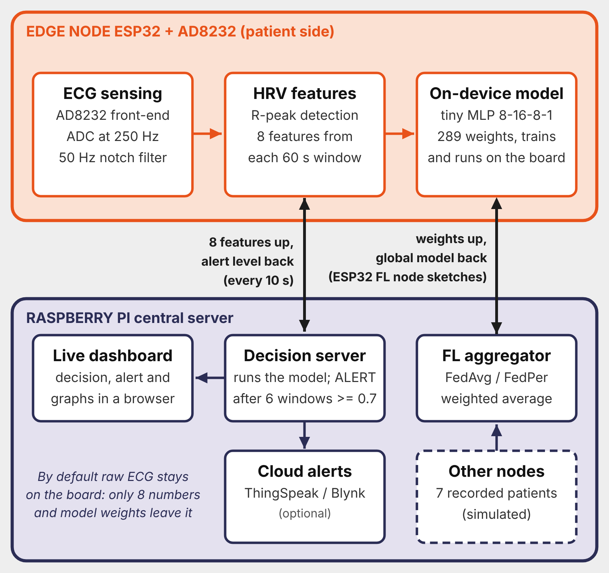

# FedApnea

Edge-enabled federated learning for sleep-apnea screening, built on an **ESP32 + AD8232 ECG** wearable and a **Raspberry Pi** server.

> Research prototype. It is a screening aid, **not a medical device and not a diagnosis**.

## What it does

1. The ESP32 reads ECG (250 Hz), filters it, finds heartbeats (R-peaks) and turns every 60 s into **8 HRV features**.
2. A tiny neural network (**8-16-8-1, 289 weights**) runs on the board and scores each minute as apnea-like or normal.
3. Every 10 s the board sends its 8 features to the Raspberry Pi. The Pi runs the same model and applies the alert rule: **ALERT after 6 windows in a row at or above 0.7, cleared after 3 below** (`--threshold` and `--sustain` change these). The level is sent back to the board and shown on a live dashboard (optional ThingSpeak / Blynk push).
4. The model is trained with **federated learning**: each patient is a node that trains locally and sends only weights. The aggregator (`fl_server.py`) averages them (**FedAvg**, or **FedPer**, which keeps the 9 head weights private). Nodes can be Python processes or the ESP32 itself, which trains the same network on the board and uploads its weights over Wi-Fi. The FedAvg weights are exported as `model_export.h` for the live sketch.



## Data

PhysioNet **Apnea-ECG Database** (real overnight ECG recordings from real patients, with per-minute apnea/normal labels), hosted by PhysioNet (MIT Laboratory for Computational Physiology). The raw data is **not** in this repo; `training/apnea_ecg_extract.py` downloads it directly from PhysioNet. The database is open access under the Open Data Commons Attribution License v1.0 (DOI 10.13026/C23W2R); keep the citations below if you reuse it.

- Penzel T, Moody GB, Mark RG, Goldberger AL, Peter JH. *The Apnea-ECG Database.* Computers in Cardiology 2000;27:255-258.
- Goldberger A, et al. *PhysioBank, PhysioToolkit, and PhysioNet.* Circulation 2000;101(23):e215-e220.

`pi_server/validation_set.h` holds 1,139 held-out windows (8 patients, 652 apnea) as derived HRV features, used for the on-board check and the demo replay.

## Results

- About **0.64 balanced accuracy** on held-out patients; the model uses only heart-beat timing.
- FedAvg vs FedPer: no significant difference; all methods plateau by about round 3.
- Per-patient scores for a01, a04, b01 and b05 are unreliable (a class has fewer than 15 windows).
- The board's probability matches the Python model (checked with `esp32_model_validate`).

## Repo layout

| Folder | Contents |
|---|---|
| `firmware/esp32_live_infer/` | Main ESP32 sketch: ECG, R-peak detector, HRV features, on-device model, posts to the Pi. Set `WIFI_SSID`, `WIFI_PASS`, `DASH_HOST` at the top. |
| `firmware/esp32_fl_node/` | ESP32 federated node, bench version: trains the model on the board on a synthetic patient and exchanges weights with `fl_server.py` (tests the plumbing). |
| `firmware/esp32_fl_node_replay/` | ESP32 federated node on a real PhysioNet patient: receives that patient's HRV features and labels over Serial, then trains and uploads on the board. |
| `firmware/esp32_fl_node_live/` | ESP32 federated node on its own live ECG: R-peaks, HRV features, on-board training and upload in one sketch. Labels are placeholders (see below). |
| `firmware/esp32_model_validate/` | Sketch that runs the model on the validation windows and prints the results, to prove board = Python. |
| `pi_server/` | `dashboard_server.py` (decision + dashboard), `demo_feeder.py` (replay of real patient windows), `fl_server.py` and `sim_nodes.py` (federated aggregator and simulated patient nodes), `spec.py`. |
| `training/` | Feature extraction from PhysioNet, training, FedAvg vs FedPer, experiments, SHAP, model export, parity checks, and the two helpers for the replay sketch (`export_patient_for_esp32.py`, `send_patient_to_esp32.py`). |
| `docs/` | Block diagram and the node/aggregator protocol (`PROTOCOL.md`). |

## Run it

**Pi: dashboard** (needs `pip install numpy`):

```
cd pi_server
python3 dashboard_server.py --model model_export.h --port 8081 --threshold 0.7 --sustain 6
```

Open `http://<pi-ip>:8081`.

**ESP32:** open `firmware/esp32_live_infer/esp32_live_infer.ino` in Arduino IDE, fill in Wi-Fi name, password and the Pi's IP (2.4 GHz Wi-Fi, same network as the Pi), upload. Opening the Serial Monitor resets the board. `ECG_STREAM` is `0` by default, so only features leave the board. Set it to `1` to draw the live ECG waveform on the dashboard; this sends a 10 s raw-ECG preview to the Pi.

**Show a positive alert without an apnea patient** (second terminal on the Pi). This replays recorded real-patient windows through the same model and alert logic; the dashboard labels it as a replay:

```
cd pi_server
python3 demo_feeder.py --server http://localhost:8081 --header validation_set.h --model model_export.h --alert-demo --interval 3
```

**Federated training with an ESP32 node** (laptop or Pi on the same Wi-Fi):

```
cd pi_server
python3 fl_server.py --mode fedper --min-nodes 2     # port 8080
```

Then open one of the `esp32_fl_node*` sketches, set `WIFI_SSID`, `WIFI_PASS` and `SERVER_IP` (the IP of the machine running `fl_server.py`) and upload. Each round the board downloads the shared weights, trains for 3 epochs, and uploads the updated weights. A second node can be `python3 sim_nodes.py` from the same folder. For the replay sketch, build one patient's file and send it over Serial (`pip install pyserial`; leave the sender window open during the run, because closing it resets the board):

```
cd training
python export_patient_for_esp32.py apnea_ecg_features.csv b05      # writes b05_for_esp32.txt
python send_patient_to_esp32.py COM5 b05_for_esp32.txt
```

The file format is `N_TRAIN n`, `N_TEST n`, `POS_WEIGHT w`, then `TRAIN f1 .. f8 label` and `TEST f1 .. f8 label` lines, then `DONE`.

**Rebuild the dataset and retrain** (needs internet and `pip install wfdb numpy`):

```
cd training
python apnea_ecg_extract.py                      # downloads records, writes apnea_ecg_features.csv
python fedavg_vs_fedper_real.py apnea_ecg_features.csv
python run_experiments.py apnea_ecg_features.csv --quick
python export_model_for_esp32.py --help          # writes model_export.h for the board
```

Use the same `model_export.h` on the board and the Pi. The dashboard shows a CRC fingerprint and tells you if they differ.

## Status and limits

- Live sensor tested on healthy volunteers only. Apnea cases are shown through the replay of recorded patients.
- On-board training runs on the ESP32 in all three `esp32_fl_node*` sketches. `esp32_fl_node_live` has no real apnea labels for live ECG (no sleep study), so it uses alternating placeholder labels: its scores mean nothing, it only shows that real ECG, HRV features, on-board training and upload work in one pipeline. Real labels come from the PhysioNet replay sketch.
- The live sketch's feature window is shorter and more frequent than the 60 s specification so a round appears within minutes on the bench, and each Wi-Fi exchange briefly pauses ECG sampling.
- `model_export.h`, `validation_set.h` and `spec.py` appear in more than one folder on purpose, so each folder runs on its own. Keep the copies identical.
- Weights are sent over local Wi-Fi without encryption.
- Not combined yet: the live-inference sketch (`esp32_live_infer`) and the federated-node sketches are separate programs.
- Planned: more PhysioNet records (a11-a20, c06-c10), SHAP results on the full set, cross-dataset federation, richer features, LoRa link, extra sensors.
